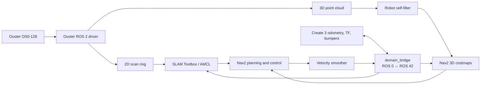

# Create 3 + Ouster OS0 Autonomous Navigation

ROS 2 Humble workspace for **2D mapping, localization, and autonomous navigation** with an iRobot Create 3, an NVIDIA Jetson Orin Nano, and an Ouster OS0-128 Rev07 LiDAR.

The repository is designed as a compact research platform for indoor mobile-robot experiments. It combines 2D LiDAR-derived SLAM with the Ouster point cloud for 3D obstacle representation in Nav2 costmaps.

> **Platform note:** The repository and ROS package retain the name `TurtleBot4Lite_OusterOS0` / `tb4_ouster_autonomy` for compatibility. The system is a custom Create 3 platform and does not use TurtleBot 4 bringup.

## System overview

The platform supports:

- 2D occupancy-grid mapping with SLAM Toolbox.
- Map saving and loading with Nav2 map tools.
- AMCL localization on a saved map.
- Single-goal and waypoint-based navigation with Nav2.
- 3D local and global costmaps from a filtered Ouster point cloud.
- Bumper-contact integration for obstacles inside the LiDAR blind spot.
- ROS domain bridging between the Create 3 and Jetson autonomy stack.
- Stationary diagnostics that do not command robot motion.



## Hardware and software

### Hardware

- iRobot Create 3 mobile base.
- NVIDIA Jetson Orin Nano.
- Ouster OS0-128 Rev07 LiDAR.
- USB Ethernet connection to the Ouster sensor.
- USB-C network connection between the Jetson and Create 3.

### Software

- Ubuntu 22.04.
- ROS 2 Humble.
- Ouster ROS 2 driver.
- Nav2.
- SLAM Toolbox.
- `domain_bridge`.
- `teleop_twist_keyboard`.
- `topic_tools`.

### Network and ROS domains

| Component | Configuration |
| --- | --- |
| Ouster sensor | `169.254.97.211` |
| Create 3 ROS graph | ROS domain `0` |
| Jetson autonomy graph | ROS domain `42` |

The launch system starts `domain_bridge` so that the Create 3 can remain on domain 0 while autonomy nodes run on domain 42. Do not set `FASTRTPS_DEFAULT_PROFILES_FILE` unless the discovery configuration has been verified for this multi-domain setup.

## Repository structure

```text
.
├── arena_map.pgm / arena_map.yaml
└── ros2_ws/src/tb4_ouster_autonomy/
    ├── config/
    │   ├── create3_domain_bridge.yaml
    │   ├── nav2_params.yaml
    │   └── slam_toolbox_params.yaml
    ├── launch/
    │   ├── robot.launch.py
    │   ├── perception.launch.py
    │   ├── mapping.launch.py
    │   └── navigate.launch.py
    ├── rviz/
    ├── tb4_ouster_autonomy/
    │   ├── cloud_filter.py
    │   ├── bumper_contact_cloud.py
    │   └── stationary_diagnostics.py
    └── test/
```

The main entry point is `robot.launch.py`. It exposes three operating modes:

| Mode | Purpose |
| --- | --- |
| `diagnose` | Inspect transforms and telemetry without commanding motion. |
| `map` | Run Ouster perception, SLAM Toolbox, and supervised teleoperation. |
| `navigate` | Localize and navigate using a saved map and Nav2. |

## Installation and build

Clone the repository, install the ROS dependencies, and build the workspace:

```bash
git clone https://github.com/Robin-Lange/TurtleBot4Lite_OusterOS0.git
cd TurtleBot4Lite_OusterOS0

source /opt/ros/humble/setup.bash
rosdep install --from-paths ros2_ws/src --ignore-src --rosdistro humble -y \
  --skip-keys "ament_python domain_bridge"

cd ros2_ws
colcon build --symlink-install
source install/setup.bash
```

Install `ros-humble-domain-bridge` on a fresh system if it is not already available. Source both `/opt/ros/humble/setup.bash` and `ros2_ws/install/setup.bash` in each new terminal.

Before operating the platform, check the network and ROS graph:

```bash
ip -brief addr
curl -fsS http://169.254.97.211/api/v1/sensor/config
ros2 topic list -t
```

The sensor configuration request is read-only. Starting the Ouster driver may apply configuration changes and reinitialize the sensor session.

## Stationary diagnostics

Run the read-only diagnostics mode before starting mapping or navigation:

```bash
source /opt/ros/humble/setup.bash
source ros2_ws/install/setup.bash
ros2 launch tb4_ouster_autonomy robot.launch.py mode:=diagnose
```

For a fixed-duration telemetry report:

```bash
ros2 run tb4_ouster_autonomy stationary_diagnostics \
  --seconds 10 --topics /odom,/tf,/dock_status
```

Add `rviz:=true` to inspect TF and sensor data. Add `start_sensor:=true` only when intentionally starting the Ouster driver.

## Mapping workflow

Mapping is a supervised, manual-driving procedure. Keep the robot in view and use a physical safety stop when necessary.

### 1. Undock the Create 3

Skip this step if the robot is already undocked:

```bash
source /opt/ros/humble/setup.bash
unset ROS_DOMAIN_ID
ros2 action send_goal /undock irobot_create_msgs/action/Undock "{}"
```

### 2. Start mapping

```bash
source /opt/ros/humble/setup.bash
source ros2_ws/install/setup.bash
ros2 launch tb4_ouster_autonomy robot.launch.py mode:=map rviz:=true
```

Wait for the scan and map to appear in RViz before driving.

### 3. Teleoperate

In a second terminal:

```bash
source /opt/ros/humble/setup.bash
source ros2_ws/install/setup.bash
export ROS_DOMAIN_ID=42
ros2 run teleop_twist_keyboard teleop_twist_keyboard
```

Drive slowly and observe the map from multiple viewpoints. Press the space bar to stop.

### 4. Save the map

```bash
source /opt/ros/humble/setup.bash
export ROS_DOMAIN_ID=42
ros2 run nav2_map_server map_saver_cli -f "$(pwd)/arena_map"
```

This produces `arena_map.pgm` and `arena_map.yaml`.

## Navigation workflow

Start navigation with the default map:

```bash
source /opt/ros/humble/setup.bash
source ros2_ws/install/setup.bash
ros2 launch tb4_ouster_autonomy robot.launch.py mode:=navigate rviz:=true
```

Use a different map with:

```bash
ros2 launch tb4_ouster_autonomy robot.launch.py \
  mode:=navigate rviz:=true map:=/absolute/path/to/map.yaml
```

In RViz:

1. Select **2D Pose Estimate** and initialize the robot pose.
2. Wait for the AMCL particle cloud to converge.
3. Send a single goal with **Nav2 Goal**, or use waypoint mode for a sequence of poses.

The supplied Nav2 configuration limits commanded velocity to `0.15 m/s` linear and `0.50 rad/s` angular. Keep the robot supervised, clear the operating area, and cancel active goals before stopping the launch process.

## Frames and perception configuration

The Create 3 provides wheel control, odometry, and the `odom -> base_link` transform. This package adds the sensor frames without duplicating Create 3 odometry.

The sensor mount publishes:

- `base_link -> os_sensor`: `x=0.005`, `y=-0.010`, `z=0.133` m.
- `os_sensor -> laser_frame`: `x=0`, `y=0`, `z=0.038195` m.

The resulting optical origin is approximately `0.171195 m` above the floor. These values assume a level sensor, a `0.090 m` plate-top height, the plate logo over the Create 3 rotation center, and the sensor cable facing rearward. Update the transform if the physical mount changes.

The perception pipeline configures the Ouster for:

- `1024x10` sensor mode.
- ROS time stamps.
- `0.30 m` minimum range.
- Full point cloud and IMU output.
- Scan ring `63` for 2D mapping and localization.

Key topics include `/ouster/points`, `/ouster/cloud_filtered`, `/ouster/scan`, and `/scan`.

## Verification

Build and run the software tests after making changes:

```bash
source /opt/ros/humble/setup.bash
cd ros2_ws
colcon build --symlink-install
source install/setup.bash
PYTHONNOUSERSITE=1 colcon test --event-handlers console_direct+
colcon test-result --all --verbose
```

These checks validate the workspace and package tests. Hardware validation should be performed separately using stationary diagnostics and supervised mapping or navigation.

## Research and design notes

This platform is intended for reproducible indoor robotics experiments involving:

- LiDAR-based SLAM and localization.
- Multi-domain ROS 2 system integration.
- 3D obstacle representation for a compact mobile base.
- Sensor self-filtering and robot–environment separation.
- Navigation safety using both LiDAR and bumper observations.

The current configuration is hardware-specific. Results may vary with sensor mounting, network topology, floor geometry, firmware versions, and ROS package versions.

## References

- [Create 3 documentation](https://iroboteducation.github.io/create3_docs/)
- [Create 3 examples — Humble](https://github.com/iRobotEducation/create3_examples/tree/humble)
- [Ouster ROS 2 driver](https://github.com/ouster-lidar/ouster-ros/tree/ros2)
- [ROS 2 Humble documentation](https://docs.ros.org/en/humble/index.html)
- [Navigation2 documentation](https://docs.nav2.org/)
- [SLAM Toolbox documentation](https://docs.ros.org/en/humble/p/slam_toolbox/)
- [Ouster coordinate frames](https://docs.ouster.com/sensor-docs/firmware/coordinate-system)
- [GitHub Markdown syntax](https://docs.github.com/en/get-started/writing-on-github/getting-started-with-writing-and-formatting-on-github/basic-writing-and-formatting-syntax)
