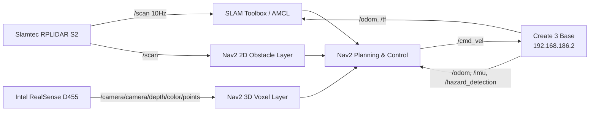

# TurtleBot 4 Lite + RealSense D455 + RPLIDAR S2 Autonomous Navigation

ROS 2 Humble workspace for **2D mapping, localization, 3D obstacle perception, and autonomous navigation** with an iRobot Create 3 base, an NVIDIA Jetson Orin Nano, an **Intel RealSense D455** depth camera, and a **Slamtec RPLIDAR S2** 2D LiDAR.

The repository is configured as an indoor mobile research platform combining high-resolution 2D planar LiDAR SLAM with depth camera 3D Voxel costmaps and bumper contact integration.

> **Platform note:** The repository and ROS package retain the name `TurtleBot4Lite_OusterOS0` / `tb4_ouster_autonomy` for compatibility. The system is a custom Create 3 platform and does not use TurtleBot 4 standard bringup. All communications run natively on **ROS Domain 0** via FastDDS.

---

## System Overview

The platform supports:
- **2D SLAM & Mapping**: Sub-millimeter planar mapping with Slamtec RPLIDAR S2 (10 Hz, 3,240 pts/rev, 30 m range) via SLAM Toolbox.
- **3D Obstacle Perception**: 3D PointCloud2 via Intel RealSense D455 (640×480 @ 30 FPS depth/color, ARM NEON point cloud generator) feeding Nav2 local & global VoxelLayers (0.35 m to 5.0 m range).
- **Tactile Safety**: Bumper-contact integration via `/hazard_detection` generating contact points for low-lying obstacles below sensor FOV.
- **Unified Domain 0 FastDDS**: Direct peer-to-peer DDS discovery with the Create 3 base over USB-C gadget interface `usb1` (8192 MTU, no domain bridge required).
- **Navigation & Tracking**: Nav2 stack with Regulated Pure Pursuit / DWB controllers, velocity smoothing, and AMCL localization.
- **Read-Only Stationary Diagnostics**: Live validation of all transforms, telemetry, and sensor streams while docked without commanding robot motion.



---

## Hardware and Software Specifications

### Hardware
- **Mobile Base**: iRobot Create 3 (docked, internal 4S Li-ion battery, 62 Hz odometry & IMU).
- **Onboard Compute**: NVIDIA Jetson Orin Nano (8GB / 40W, aarch64, JetPack 6, Linux 5.15).
- **2D LiDAR**: Slamtec RPLIDAR S2 (USB to serial `/dev/rplidar`, 1,000,000 baud, `DenseBoost`).
- **Depth Camera**: Intel RealSense D455 (USB 3.2 SuperSpeed, stereo baseline 95 mm, global shutter 640×480 @ 30 FPS RGBD).
- **Interconnect**: Dedicated high-speed USB-C cable from Jetson Orin Nano to Create 3 cargo bay board.

### Software
- **Operating System**: Ubuntu 22.04 LTS (Jammy Jellyfish).
- **ROS Distribution**: ROS 2 Humble Hawksbill.
- **Middleware**: `rmw_fastrtps_cpp` with custom FastDDS XML profile (`config/fastdds_create3.xml`).
- **Key ROS Packages**:
  - `rplidar_ros` (Slamtec S2 driver)
  - `realsense2_camera` (Intel RealSense ROS 2 wrapper with ARM NEON point cloud support)
  - `slam_toolbox` (Lifelong / synchronous 2D SLAM)
  - `nav2_bringup` (Navigation2 stack)

---

## Network & ROS Domain Configuration

The entire autonomy stack, sensor drivers, and Create 3 base run **natively on ROS Domain 0**:

| Component | Configuration | Notes |
| --- | --- | --- |
| Create 3 Base | `192.168.186.2` | Web dashboard at `http://192.168.186.2` |
| Jetson Gadget IP | `192.168.186.3` | `usb1` interface (`create3-usb1`), metric 50 |
| Multicast Route | `224.0.0.0/4 dev usb1` | Required for DDS multicast discovery |
| ROS Domain | `0` | Direct native graph (no `domain_bridge`) |
| Middleware Profile | `config/fastdds_create3.xml` | 8192 MTU, whitelist `192.168.186.3` & `127.0.0.1` |

### Environment Setup
Export these variables in every terminal before running ROS 2 commands:

```bash
source /opt/ros/humble/setup.bash
source /home/ivlaborin2/TurtleBot4Lite_OusterOS0/ros2_ws/install/setup.bash
export ROS_DOMAIN_ID=0
export RMW_IMPLEMENTATION=rmw_fastrtps_cpp
export FASTRTPS_DEFAULT_PROFILES_FILE=/home/ivlaborin2/TurtleBot4Lite_OusterOS0/config/fastdds_create3.xml
```

---

## Hardware Setup & Troubleshooting Guide

### 1. Jetson-to-Create 3 USB-C Wiring
- Connect a high-speed data-rated USB-C to USB-C cable from the Jetson Orin Nano USB-C port to the USB-C port on the adapter board in the Create 3 cargo bay.
- The Jetson port operates in dual-role (device mode), exposing `usb0` (192.168.55.1) and `usb1` (192.168.186.3).

### 2. NetworkManager & L4T USB Gadget Conflict
- On Jetson Linux (L4T), if NetworkManager auto-creates an interface profile named `l4tbr0`, the boot script `nv-l4t-usb-device-mode-start.sh` fails with:
  ```text
  add bridge failed: Device or resource busy (device l4tbr0 already exists)
  ```
  This prevents `tegra-xudc` from binding and leaves `usb0`/`usb1` missing.
- **Fix:**
  ```bash
  sudo nmcli con delete l4tbr0
  sudo systemctl restart nv-l4t-usb-device-mode.service
  sudo nmcli con up create3-usb1
  ```

### 3. FastDDS Profile & Message Size (8192 MTU)
- The Create 3 base firmware uses an embedded FastDDS profile configured with `maxMessageSize: 8192`.
- Standard FastDDS on Ubuntu defaults to 65,500 bytes; without matching the message size, discovery or message deserialization fails.
- When whitelisting interfaces, both `192.168.186.3` AND `127.0.0.1` must be included so local nodes (RViz, sensor nodes, SLAM) can communicate via loopback.
- Use `config/fastdds_create3.xml`:
  ```bash
  export ROS_DOMAIN_ID=0
  export RMW_IMPLEMENTATION=rmw_fastrtps_cpp
  export FASTRTPS_DEFAULT_PROFILES_FILE=/home/ivlaborin2/TurtleBot4Lite_OusterOS0/config/fastdds_create3.xml
  ```

### 4. Clock Synchronization & App Restart
- The Create 3 has no RTC battery. After extended power-off or cable disconnects, its clock drifts.
- When clocks differ significantly, ROS 2 node timers freeze and nodes will not publish telemetry.
- **Sync procedure:**
  ```bash
  # Step 1: Tell Create 3 ntpd to sync to Jetson chrony server
  curl -X POST http://192.168.186.2/api/restart-ntpd

  # Step 2: Restart Create 3 application so nodes bind to synced time
  curl -X POST http://192.168.186.2/api/restart-app
  ```
  Wait ~15–20 seconds for `create-platform` nodes to initialize and publish `Ready to go!`.

### 5. Sensor QoS Policy
- Create 3 topics (`/battery_state`, `/odom`, `/dock_status`, `/hazard_detection`) publish using Best Effort reliability and volatile durability.
- To inspect from CLI, specify the message type and Best Effort QoS:
  ```bash
  ros2 topic echo /battery_state sensor_msgs/msg/BatteryState     --qos-reliability best_effort --qos-durability volatile --once
  ```

### 6. Battery Characteristics & Compatibility
- **Stock Create 3 Battery:** 4S Li-ion pack (~14.4V nominal, ~16.8V max charged, ~13.2V cutoff).
- **Warning on External Batteries:**
  - A 14.6V maximum rating corresponds to a 4S LiFePO4 battery (4 × 3.65V = 14.6V).
  - **Warning:** Do NOT place a LiFePO4 battery on the standard Create 3 charging dock. The dock charger charges up to ~16.8V for Li-ion, which would dangerously overcharge and damage a LiFePO4 pack.

---

## Physical Extrinsics & Transforms

All physical coordinate offsets are measured from `base_link` (center of the wheel axle on the ground plane):

- **Top Mounting Plate**: $z = 0.090$ m above ground.
- **Slamtec RPLIDAR S2**:
  - Center is $1$ cm behind robot center ($x = -0.010$ m) and $0.5$ cm to the left ($y = +0.005$ m).
  - Optical plane is $28$ mm above mounting plate $\Rightarrow z = 0.090 + 0.028 = 0.118$ m.
  - Frame transform: `base_link -> laser`: `[-0.010, 0.005, 0.118, 0, 0, 0]`.
- **Intel RealSense D455**:
  - Center is $4$ cm behind LiDAR center $\Rightarrow x = -0.050$ m.
  - Camera center is $0.5$ cm to the right of robot center $\Rightarrow y = -0.005$ m.
  - Camera optical center is $8.6$ cm above the mounting plate $\Rightarrow z = 0.090 + 0.086 = 0.176$ m.
  - Frame transform: `base_link -> camera_link`: `[-0.050, -0.005, 0.176, 0, 0, 0]`.
  - Camera optical frames (`camera_depth_optical_frame`, `camera_color_optical_frame`) are published automatically by `realsense2_camera`.

Transforms are published statically in `ros2_ws/src/tb4_ouster_autonomy/launch/mount_tf.launch.py`.

---

## Operating Instructions

### 1. Build & Test Workspace

```bash
source /opt/ros/humble/setup.bash
cd /home/ivlaborin2/TurtleBot4Lite_OusterOS0/ros2_ws
colcon build --symlink-install
source install/setup.bash

# Run automated tests
colcon test --packages-select tb4_ouster_autonomy
colcon test-result --all --verbose
```

### 2. Stationary Diagnostics (Docked Mode)

Run the diagnostics without moving the robot to verify that all sensors, transforms, and base telemetry are healthy:

```bash
export ROS_DOMAIN_ID=0
export RMW_IMPLEMENTATION=rmw_fastrtps_cpp
export FASTRTPS_DEFAULT_PROFILES_FILE=/home/ivlaborin2/TurtleBot4Lite_OusterOS0/config/fastdds_create3.xml

# Run with sensor drivers launched:
ros2 launch tb4_ouster_autonomy robot.launch.py mode:=diagnose start_sensor:=true
```

Expected topic streams:
- `/scan`: ~10 Hz (Slamtec RPLIDAR S2)
- `/camera/camera/color/image_raw`: ~30 FPS (D455 RGB)
- `/camera/camera/depth/image_rect_raw`: ~30 FPS (D455 Depth)
- `/camera/camera/depth/color/points`: ~15 Hz (D455 3D Point Cloud)
- `/odom`: ~20-62 Hz (Create 3 wheel odometry)
- `/imu`: ~62-100 Hz (Create 3 internal IMU)
- `/hazard_detection`: ~62 Hz (Create 3 bump/cliff sensors)
- `/battery_state`: ~1 Hz (Create 3 battery telemetry)
- `/dock_status`: ~1 Hz (`is_docked: true`)

### 3. Mapping Workflow (SLAM Toolbox)

When ready to map in an environment:

1. **Undock the Create 3** (if docked):
   ```bash
   ros2 action send_goal /undock irobot_create_msgs/action/Undock "{}"
   ```
2. **Start mapping**:
   ```bash
   ros2 launch tb4_ouster_autonomy robot.launch.py mode:=map rviz:=true
   ```
3. **Teleoperate**:
   In another terminal:
   ```bash
   ros2 run teleop_twist_keyboard teleop_twist_keyboard
   ```
4. **Save map**:
   ```bash
   ros2 run nav2_map_server map_saver_cli -f "$(pwd)/arena_map"
   ```

### 4. Autonomous Navigation (Nav2)

To navigate using a saved map:

```bash
ros2 launch tb4_ouster_autonomy robot.launch.py mode:=navigate rviz:=true map:=/absolute/path/to/arena_map.yaml
```

1. Set the initial robot pose in RViz with **2D Pose Estimate**.
2. Send navigation goals using **Nav2 Goal**.

---

## Research & Architectural Analysis

### Goal 4: Vision-Language-Action (VLA) Target Following
- **RealSense 2026 Trends Alignment**: Combines edge visual-spatial intelligence (wide 86°×57° FOV, global shutter, 95 mm baseline depth) with foundation vision-language models.
- **Hardware Physics (D435 vs. D455)**: The D455 increases baseline from 50 mm to 95 mm, reducing Z-depth error by half at 4 m ($<2\%$ Z-error at 4 m), providing stable target tracking and person following across 0.4 m to 6.0 m.
- **Distributed Edge Compute Topology**:
  - *Onboard (Jetson Orin Nano inside robot)*: Real-time 30 Hz capture, NVENC H.264 stream compression ($<1.5$ Mbps), local ByteTrack object tracking, Nav2 obstacle avoidance, and safety watchdog.
  - *Offboard (Jetson Orin AGX on dedicated 5 GHz Wi-Fi)*: Quantized OpenVLA-7B / SmolVLM-Instruct running at 3–5 Hz, emitting high-level target bounding boxes and following directives.
  - *Fail-Safe Watchdog*: 10 Hz heartbeat failsafe halts navigation if Wi-Fi latency exceeds 150 ms.

### Goal 5: Custom Acceleration Controller Adapter
- **Constant Time Headway (CTH) Spacing Policy**:
  $$d_{\text{des}} = d_0 + h \cdot v_{\text{follower}}$$
  where $d_0 = 0.8\text{ m}$ standoff and $h = 1.0\text{ s}$ headway time.
- **Wheel Slip & Jerk Limiting**:
  Create 3 wheel contact limits maximum linear acceleration to $a_{\text{cmd}} \le 0.5\text{ m/s}^2$ and angular acceleration to $\alpha_{\text{cmd}} \le 1.2\text{ rad/s}^2$, with jerk clamped at $j \le 1.5\text{ m/s}^3$ to prevent tire skid on slick flooring.
- **Multi-Tier Safety Gate Hierarchy**:
  1. *Hardware Bumper Gate* (`/hazard_detection`): Immediate zero-velocity estop.
  2. *LiDAR Proximity Gate* (`/scan` min distance $<0.35$ m): Automatic deceleration and stop.
  3. *Costmap Obstacle Inflation Gate* (Nav2 D455 VoxelLayer): Path replanning around dynamic obstacles.

---

## References

- [Create 3 Documentation & Setup](https://iroboteducation.github.io/create3_docs/setup/ubuntu2204/)
- [RealSense ROS Documentation](https://github.com/realsenseai/realsense-ros)
- [Intel RealSense D455 Specifications](https://www.intel.com/content/www/us/en/products/sku/205847/intel-realsense-depth-camera-d455/specifications.html)
- [Slamtec RPLIDAR S2 User Manual & SDK](https://github.com/slamtec/rplidar_sdk)
- [NVIDIA Isaac ROS RealSense Setup](https://nvidia-isaac-ros.github.io/v/release-3.2/getting_started/hardware_setup/sensors/realsense_setup.html)
