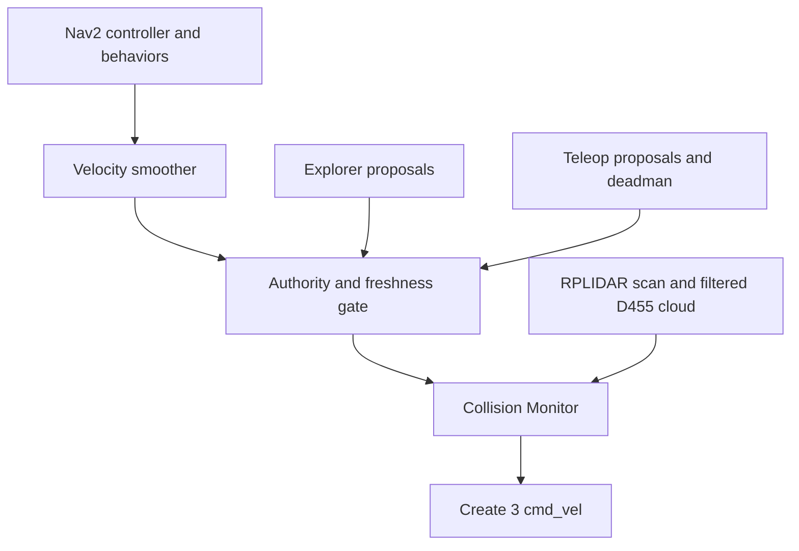

# Create 3 + RPLIDAR S2 + RealSense D455

ROS 2 Humble mapping and navigation workspace for a custom iRobot Create 3 with a Jetson Orin Nano. The repository and package names retain `TurtleBot4Lite_OusterOS0` and `tb4_ouster_autonomy` for compatibility. This branch uses **RPLIDAR S2 and D455**, not an Ouster sensor or TurtleBot 4 standard bringup.

The code supports stationary diagnostics, manual SLAM, autonomous frontier mapping, and Nav2 localization/navigation. Software tests do not verify physical wiring, power capacity, firmware, or mounting calibration. See [the hardware and code audit](docs/HARDWARE_AUDIT.md) for findings, sources, and checks still needed on the robot.

## Runtime architecture



| Component | Role |
| --- | --- |
| `components.py` | Data-only robot authority, sensor samples, command-source entities, configuration, decisions |
| `systems.py` | Pure authority, timestamp checks, command selection, rigid transforms, cropping, contact geometry |
| `safety_authority_gate.py` | ROS subscriptions replace components; a timer runs the safety system and publishes its decision |
| `cloud_filter.py` | Reads PointCloud2, transforms at acquisition time into `base_link`, then calls the cropping system |
| `mapping.py` | Frontier extraction and map serialization without ROS dependencies |
| `visibility.py` / `visibility_monitor.py` | Pure scan-edge observations and an optional passive ROS/RViz adapter |
| `autonomous_explorer.py` | ROS action lifecycle, mission sequencing, and map checkpoints |
| `bringup.py` | Shared Nav2 component composition for mapping and localization |

This is a small entity-component-system design: entities have data components and functions perform decisions. ROS nodes remain transport adapters and lifecycle owners. It does not add a game engine or a second middleware runtime. The design follows the transport/policy separation and explicit operator authority in [the distributed autonomy platform](https://github.com/Robin-Lange/distributed-collaborative-autonomy-platform/blob/main/OVERVIEW.md).

## Sensor and command contracts

| Input/output | Topic / frame |
| --- | --- |
| RPLIDAR S2 | `/scan`, `laser`; serial 1,000,000 baud, DenseBoost |
| D455 point cloud | `/camera/camera/depth/color/points`, driver optical frame |
| Filtered obstacles | `/camera/cloud_filtered`, `base_link`, original acquisition timestamp |
| Base telemetry | `/odom`, `/tf`, `/dock_status`, `/hazard_detection` |
| Nav2 smoothed proposal | `/nav2/cmd_vel` |
| Explorer proposal | `/explorer/cmd_vel` |
| Teleop proposal / heartbeat | `/teleop/cmd_vel`, `/teleop/deadman` |
| Gate output / status | `/cmd_vel_safe`, `/safety/status` |
| Final external velocity writer | Collision Monitor → `/cmd_vel` |

All moving modes include the gate and Collision Monitor. Required telemetry includes both receipt and acquisition age for odometry, dynamic TF, scan, camera cloud, dock status, and hazard status. Contact, cliff, stall, wheel drop, and operator stop latch zero output. There is no automatic bumper backup. The robot's native reflexes remain enabled.

Manual input pauses autonomous velocity forwarding until `/safety/resume`. Closing teleop does not resume autonomy. Teleop heartbeat is required only for manual commands. Default caps are 0.15 m/s and 0.50 rad/s; these are conservative application settings, not certified hardware limits. A normal held velocity remains subject to the input timeout. Built-in Create 3 actions such as undocking are separate base-side behaviors; the explorer cancels its action on stop.

## Installation and setup

On Ubuntu 22.04 with ROS 2 Humble already installed:

```bash
./scripts/install_dependencies.sh
source setup_env.sh
```

Dependencies are declared in `package.xml` and installed through rosdep. Installation creates a dialout-only CP210x serial rule. If several CP210x adapters are attached, qualify the rule with the S2 adapter's serial number. Log out and back in after changing group membership.

Network changes are separate:

```bash
CREATE3_IF=usb1 ./scripts/install_dependencies.sh --configure-network
```

Verify the actual gadget interface first (`ip -br addr`). The supplied robot profile expects `192.168.186.3`, with Create 3 at `192.168.186.2`; the AGX profile expects `192.168.0.10`. Review all interface whitelist addresses before use. `setup_env.sh` defaults to domain 0/Fast DDS and respects explicit domain, middleware, and profile settings. Launch files do not overwrite them. Synchronize the Create 3 and Jetson clocks; never fix TF problems by stamping stale poses as current. The base normally publishes its own odometry TF.

Mount transforms retain the previous branch's offsets as **unverified calibration inputs**: `base_link→laser = (-0.010, 0.005, 0.118) m`, `base_link→camera_link = (-0.050, -0.005, 0.176) m`, zero rotation. Re-measure these against the actual Create 3 frame and camera reference point. Mount launch arguments include position/yaw; additional pitch/roll can be supplied as described in the audit.

## Operation

Start with read-only diagnostics:

```bash
source setup_env.sh
ros2 launch tb4_ouster_autonomy robot.launch.py mode:=diagnose start_sensor:=true
```

Manual mapping and teleop, in separate terminals:

```bash
ros2 launch tb4_ouster_autonomy robot.launch.py mode:=map
ros2 run tb4_ouster_autonomy teleop_keyboard
```

Save a manual map:

```bash
mkdir -p ~/maps
ros2 run nav2_map_server map_saver_cli -f ~/maps/arena_map
```

Autonomous mapping (includes an explicitly requested undock in the wrapper) and subsequent navigation:

```bash
./scripts/run_autonomous_mapping.sh [optional_output_prefix]
./scripts/run_autonomous_navigation.sh [optional_map_yaml]
```

The default map is `~/maps/arena_map.yaml`. Existing maps are backed up before mapping; saves go to a user-owned directory. Checkpoints occur every 20 seconds when a map is available. Shutdown attempts a final save, but file IO and abrupt power loss can still prevent it. Navigation requires a suitable map and an AMCL initial pose, for example through RViz:

```bash
ros2 launch tb4_ouster_autonomy robot.launch.py mode:=navigate rviz:=true map:=$HOME/maps/arena_map.yaml
```

After clearing a fault and verifying fresh telemetry:

```bash
ros2 service call /safety/resume std_srvs/srv/Trigger '{}'
```

The scripts stop their own launch process group. They do not kill unrelated ROS processes or publish around the gate.

## Optional visibility observations

With `/scan` already running, start the passive monitor separately:

```bash
ros2 launch tb4_ouster_autonomy visibility.launch.py
ros2 topic echo /visibility/diagnostics
```

In RViz, add a **Marker** display for `/visibility/edges` and use a fixed frame connected to the scan frame. Orange points mark the nearer finite return at a nearby range discontinuity: a **candidate occlusion boundary**, not an obstacle prediction or a proven hidden region. `DiagnosticStatus.OK` means only that a full-circle scan with enough finite returns was processed without detected edges; it never means the route is safe. Missing/infinite/out-of-range returns remain unknown. Malformed, stale, future-dated, or unstamped scans clear the points. Each point set keeps the scan's original frame and first-ray timestamp; it is not motion-deskewed.

The defaults look for a range jump of at least 0.75 m, with the near return within 6 m and adjacent beams no more than 0.05 rad apart. The finite-return warning threshold is 50%, and the acquisition/receipt timeout is 0.5 s. These are diagnostic heuristics, not calibrated safety parameters. Full-circle seams and either scan direction are supported; partial fields of view are reported explicitly. Slanted surfaces, thin objects, and noise can create false positives; missing returns and unobserved/overhanging objects can hide real boundaries.

For parameter overrides, run the node directly, for example:

```bash
ros2 run tb4_ouster_autonomy visibility_monitor --ros-args -p range_jump_m:=1.0 -p scan_topic:=/scan
```

For recorded-data inspection, launch with `use_sim_time:=true` and replay the scan plus TF and `/clock`. Diagnostic output is rate-limited to 5 Hz and only the newest received scan is processed; this is not an exhaustive bag evaluator. Record `/scan`, `/tf`, `/tf_static`, `/odom`, `/visibility/diagnostics`, and `/visibility/edges` for later comparisons.

This module has no motion authority and is not included in normal bringup. Its purpose is to inspect real visibility data before considering occlusion-aware control. No QP solver, learned predictor, or extra middleware is added. A future controller needs conservative hidden-region construction, measured braking/latency bounds, and matched comparisons against the existing stack and a simple visibility-based slowdown.

## Verification

Pure systems and configuration tests run without ROS:

```bash
python3 -m pip install pytest numpy pyyaml
python3 -m pytest -q ros2_ws/src/tb4_ouster_autonomy/test
```

ROS adapter and Collision Monitor integration tests require the built Humble workspace:

```bash
source setup_env.sh
cd ros2_ws
colcon build --symlink-install
colcon test --packages-select tb4_ouster_autonomy --event-handlers console_direct+
colcon test-result --all --verbose
```

Tests use domain 88 and localhost-only discovery. CI runs on integration-branch pushes and all PRs, builds and tests on x86-64 and native ARM64, and rejects skipped ROS tests. See [CI configuration and required checks](docs/CI.md). The integration test verifies actual final velocity output under healthy telemetry, a nearby obstacle, cleared obstacles, and camera dropout.

## Offboard compute and Zenoh

Fast DDS remains the Create 3 transport. A native Zenoh process cannot replace the embedded DDS endpoint by changing an environment variable. A future offboard Zenoh bridge should expose a small allowlist of telemetry and high-level requests, keep all local safety checks, and be benchmarked against the current link before adoption. See [offboard networking](docs/JETSON_AGX_ORIN_SETUP.md). No VLA controller or `/vla/cmd_vel` watchdog is implemented in this branch.

## References and attribution

- Taekyung Kim, Hun Kuk Park, Renya Wada, Nikolay Atanasov, Shumon Koga, and Dimitra Panagou (2026), **OcclusionCBF: Backup Control Barrier Functions for Safe Navigation Among Hidden Dynamic Obstacles**. [Paper](https://arxiv.org/abs/2609.06342), [project](https://www.taekyung.me/occlusion-cbf), [source repository](https://github.com/tkkim-robot/occlusion-cbf/tree/1c64a22621554280c45aae54afcb404c90d0d4a6). This work motivated inspecting visibility separately from observed obstacles. The passive scan-edge heuristic here was independently implemented; no upstream source code is copied or vendored. It does not implement OcclusionCBF's reachable occupancy, backup certificates, QP, or theoretical guarantees.
- ROS 2 Humble [LaserScan message contract](https://github.com/ros2/common_interfaces/blob/humble/sensor_msgs/msg/LaserScan.msg): scan-frame bearings, first-ray acquisition stamp, and valid range limits.
