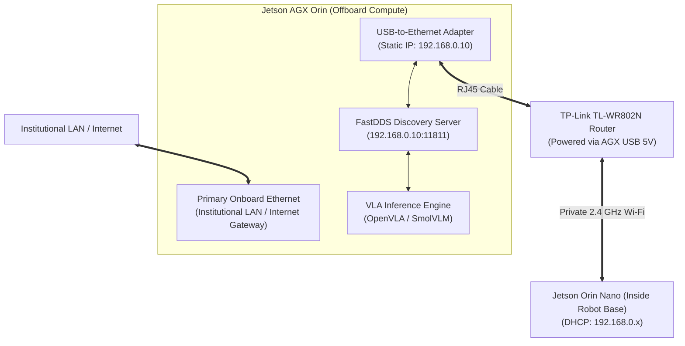

# NVIDIA Jetson AGX Orin Setup Guide: Dual-Network VLA Streaming

This guide explains how to set up the **offboard NVIDIA Jetson AGX Orin** for high-performance Vision-Language-Action (VLA) model inference (e.g., OpenVLA, Octo, SmolVLM) communicating with the mobile robot's **Jetson Orin Nano**.

This configuration establishes a **dual-network setup** on the AGX Orin:
1. **Institutional/University Network (Primary):** Connected via the AGX onboard Ethernet port for high-speed Internet access, package installation, PyTorch, and model weight downloads.
2. **Private Robot Network (Secondary):** Connected via a USB-to-Ethernet adapter to a TP-Link TL-WR802N nano router, providing an isolated, high-speed 2.4 GHz wireless link to the robot without interference from campus firewalls or network restrictions.

---

## Architecture Overview



---

## Hardware Interconnect

1. **Internet Connection:** Keep your standard institutional Ethernet cable plugged into the AGX Orin's onboard RJ45 port.
2. **Router Power:** Connect the micro-USB power cable of the TP-Link TL-WR802N into any USB port on the AGX Orin ($5\text{V} / 1\text{A}$).
3. **Router Data:** Plug the USB-to-Ethernet adapter into another USB port on the AGX Orin, and connect its RJ45 port to the Ethernet port of the TP-Link router.

---

## Step 1: Configure the USB-to-Ethernet Adapter on AGX Orin

Run the automated helper script on the AGX Orin:

```bash
# Clone the repository on the Jetson AGX Orin:
git clone -b feature/realsense-rplidar-navigation https://github.com/Robin-Lange/TurtleBot4Lite_OusterOS0.git
cd TurtleBot4Lite_OusterOS0

# Run the automated network setup:
./scripts/setup_agx_orin_network.sh
```

### Manual Configuration (Alternative)
If configuring manually via NetworkManager:

1. Identify the USB adapter interface name:
   ```bash
   nmcli device
   # Look for the USB adapter name, e.g. eth1 or enx00e04c...
   ```
2. Configure the static connection profile:
   ```bash
   USB_IF="<YOUR_USB_INTERFACE_NAME>"

   sudo nmcli connection add type ethernet con-name "robot-link" ifname "$USB_IF" ip4 192.168.0.10/24
   sudo nmcli connection modify "robot-link" ipv4.never-default yes
   sudo nmcli connection modify "robot-link" connection.autoconnect yes
   sudo nmcli connection up "robot-link"
   ```

> [!IMPORTANT]
> The setting `ipv4.never-default yes` prevents Linux from routing general internet traffic through the private router. 100% of your internet traffic remains on the institutional Ethernet port.

---

## Step 2: Connect the Robot (Jetson Orin Nano) to Router Wi-Fi

On the mobile robot's Jetson Orin Nano:

1. Scan for the TP-Link Wi-Fi network (SSID printed on the router label, e.g., `TP-Link_XXXX`):
   ```bash
   sudo nmcli dev wifi list
   ```
2. Connect to the router Wi-Fi:
   ```bash
   sudo nmcli dev wifi connect "<ROUTER_SSID>" password "<ROUTER_PASSWORD>"
   ```
3. Test connectivity to the AGX Orin:
   ```bash
   ping -c 3 192.168.0.10
   ```
   Expected response: $<3\text{ ms}$ round-trip latency.

---

## Step 3: Pure Unicast FastDDS Configuration (Optimized Dataflow)

Wi-Fi routers throttle multicast packets (`239.255.0.1`), which degrades high-rate camera and LiDAR streams. This repository uses **pure unicast UDP peer-to-peer FastDDS profiles** on both Jetsons so that:
- The **Jetson Orin Nano** simultaneously communicates with the **Create 3 base** (`192.168.186.2` over USB-C) and the **Jetson AGX Orin** (`192.168.0.10` over Wi-Fi) without exceeding Create 3's 4-locator limit.
- All discovery and telemetry dataflow (`65536` byte socket buffers, `8192` MTU alignment) travels over direct unicast UDP.

### 1. On Both Jetsons (Automatic Profile Selection)
Simply source `setup_env.sh` in any terminal:

```bash
cd ~/TurtleBot4Lite_OusterOS0
source setup_env.sh
```
`setup_env.sh` automatically detects whether it is running on the **Jetson AGX Orin** (`192.168.0.10` $\to$ loads `config/fastdds_agx_orin.xml`) or on the **Robot's Jetson Orin Nano** ($\to$ loads `config/fastdds_create3.xml`).

---

## Step 4: Headless SSH Operation (Orin Nano Inside Create 3 Bay)

Once the Jetson Orin Nano is placed inside the Create 3 cargo bay (with only **Power**, **Create 3 USB-C**, **RealSense D455 USB**, and **RPLIDAR S2 USB** plugged in):

### 1. SSH into the Robot from the Jetson AGX Orin
```bash
ssh ivlaborin2@192.168.1.100   # (or 192.168.0.100 depending on router subnet)
```

### 2. Autonomous Frontier Mapping & Auto-Save (No Manual Mapping Required!)
Start autonomous frontier exploration directly over SSH:
```bash
cd ~/TurtleBot4Lite_OusterOS0
./scripts/run_autonomous_mapping.sh
```
- **Auto-Undock:** Automatically undocks from the Create 3 charging dock if docked.
- **360° Initial Scan & Frontier Exploration:** Spins once to seed `slam_toolbox`, detects unexplored frontiers in `/map`, and dispatches Nav2 `NavigateToPose` goals while avoiding 3D obstacles with the RealSense D455 and RPLIDAR S2.
- **Automatic Map Saving:** Checkpoints `arena_map.pgm` and `arena_map.yaml` every 20 seconds and **automatically saves the final map when exploration completes OR when you press `Ctrl+C` in SSH**.

### 3. Autonomous Navigation on the Saved Map
After mapping completes (or after you abort with `Ctrl+C`), start autonomous navigation over SSH:
```bash
cd ~/TurtleBot4Lite_OusterOS0
./scripts/run_autonomous_navigation.sh
```

### 4. Inspect Live Streams & Send Goals from the Jetson AGX Orin
In a terminal on the **Jetson AGX Orin**:
```bash
cd ~/TurtleBot4Lite_OusterOS0
source setup_env.sh

# Verify incoming topics from the robot over unicast UDP:
ros2 topic list
ros2 topic hz /camera/camera/color/image_raw/compressed
```

---

## Step 5: VLA Inference Integration (Python Template)

On the Jetson AGX Orin, subscribe to the compressed image stream and publish control actions:

```python
import rclpy
from rclpy.node import Node
from sensor_msgs.msg import CompressedImage
from geometry_msgs.msg import Twist
import cv2
import numpy as np

class VLATargetFollower(Node):
    def __init__(self):
        super().__init__('vla_target_follower')
        self.sub = self.create_subscription(
            CompressedImage,
            '/camera/camera/color/image_raw/compressed',
            self.image_callback,
            10
        )
        self.cmd_pub = self.create_publisher(Twist, '/cmd_vel', 10)
        self.get_logger().info('VLA Follower Node initialized on Jetson AGX Orin.')

    def image_callback(self, msg):
        # 1. Decode JPEG image directly in memory (<5ms)
        np_arr = np.frombuffer(msg.data, np.uint8)
        cv_image = cv2.imdecode(np_arr, cv2.IMREAD_COLOR)

        # 2. Run your VLA Model inference here (e.g. OpenVLA / SmolVLM)
        # action = vla_model.predict(cv_image, prompt="follow the person")
        
        # 3. Publish velocity command to robot base
        twist = Twist()
        twist.linear.x = 0.1  # Example output
        twist.angular.z = 0.0
        self.cmd_pub.publish(twist)

def main():
    rclpy.init()
    node = VLATargetFollower()
    rclpy.spin(node)
    node.destroy_node()
    rclpy.shutdown()

if __name__ == '__main__':
    main()
```
